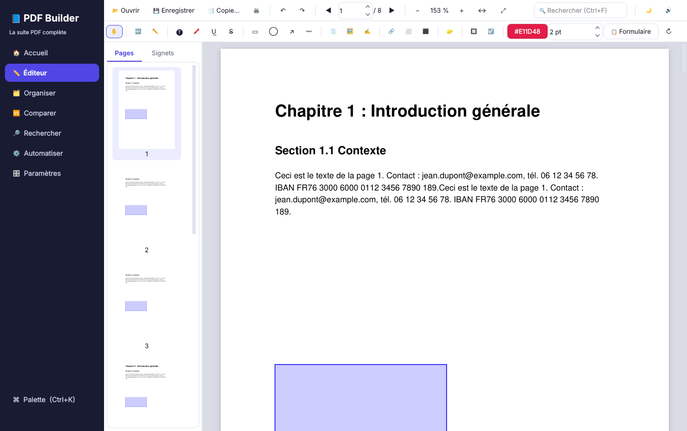
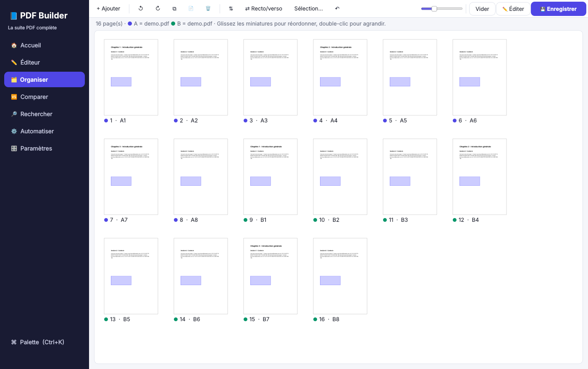

# 📘 PDF Builder

**La suite PDF de bureau complète, rapide et 100 % locale.**
PDF Builder reprend l'ensemble des fonctionnalités de PDFsam Enhanced / Visual / Pro (fusion, découpe, édition, conversion, OCR, sécurité, signature…). Il y ajoute des fonctions inédites : assistant intelligent, recettes d'automatisation, dossier surveillé, comparaison de versions, recherche multi-documents, caviardage RGPD, export Markdown pour l'IA, palette de commandes…

Vos documents ne quittent jamais votre ordinateur : aucun envoi vers un serveur.


---

## ✨ Fonctionnalités

**54 outils**, utilisables un par un ou par lots de centaines de fichiers.

### 🗂️ Organiser
| Outil | Détails |
|---|---|
| Fusionner | PDF **et images** mélangés, signets par fichier ou d'origine, **page de sommaire cliquable**, page blanche automatique pour l'impression recto-verso, format uniforme |
| Diviser | toutes les N pages, une page par fichier, avant des pages précises, plages personnalisées, **par signets**, **par taille max (Mo)**, **aux pages blanches séparatrices**, paires/impaires |
| Extraire / supprimer / réordonner des pages | syntaxe souple : `1-3,5,8-fin`, `paires`, `fin-2`, ordre libre `3,1,2` |
| Faire pivoter | toutes les pages, une sélection, ou seulement les pages en portrait/paysage |
| Alterner (recto/verso) | reconstitue un scan recto puis verso (inversion automatique du verso) |
| Insérer un PDF | à une position, à la fin, ou **toutes les N pages** (ex. intercalaires) |
| Pages blanches | ajout (début, fin, après chaque page, positions, compléter à un nombre pair) et **suppression automatique** (y compris scans bruités) |
| N-up, Livret | 2 à 16 pages par feuille ; imposition pour livret plié/agrafé |
| Redimensionner, Rogner | A3/A4/A5/Letter/Legal ; rognage **automatique autour du contenu** ou marges fixes |
| Couper en deux | scans de doubles pages / livres ouverts |

### ✏️ Éditer & annoter
- **Éditeur visuel** : défilement continu, zoom fluide, miniatures, signets (ajout, renommage, suppression, **génération automatique**), recherche surlignée, lecture nocturne, **lecture à voix haute**, impression.
- **Modification du texte existant** : cliquez sur un texte, corrigez-le.
- Ajout de texte, surlignage, soulignement, barré, rectangles, ellipses, flèches, dessin à main levée, notes, liens, images.
- **Signature manuscrite** : dessin à la souris ou au stylet, signature tapée stylisée, ou image importée (fond rendu transparent). Les signatures sont mémorisées.
- **Blanco** et **caviardage** de zones (suppression réelle du contenu sous-jacent).
- **Formulaires** : remplissage de tous les champs, **création de champs** (texte, cases à cocher).
- Gestion des pages : pivoter, insérer, dupliquer, extraire, supprimer. Annuler/rétablir illimité (30 niveaux).
- Outils en lot : **filigrane** (texte ou image, diagonale, mosaïque, opacité, devant/derrière), **numérotation** (chiffres arabes/romains, position, miroir), **en-têtes & pieds de page** avec variables (`{n}`, `{total}`, `{date}`, `{fichier}`, `{titre}`…), **numérotation Bates** continue sur plusieurs documents, **tampons** (Approuvé, Payé, Confidentiel…), **QR codes**, horodatage, aplatissement, suppression d'annotations.
- **Publipostage de formulaire** : un PDF rempli par ligne d'un fichier CSV, Excel ou JSON.

### 🔄 Convertir
- PDF → **Word** (.docx modifiable), **Excel** (détection des tableaux), **PowerPoint**, **images** (PNG/JPEG/TIFF), **texte**, **HTML**, **Markdown pour l'IA** (ChatGPT, Claude, Notion, Obsidian).
- **Images → PDF** (rotation EXIF, TIFF multipages), **Office → PDF** (Word, Excel, PowerPoint, OpenDocument via LibreOffice), **Texte/Markdown/HTML → PDF**.
- **PDF/A** (archivage légal) via Ghostscript ; **conversion en image** anti-copie (option niveaux de gris).

### 🔒 Sécurité
- Protection **AES-256** : mot de passe d'ouverture et restrictions (impression, copie, modification, annotations).
- Suppression du mot de passe.
- **Caviardage RGPD intelligent** : termes, expressions régulières et détection automatique des e-mails, téléphones, IBAN, cartes bancaires, n° de sécurité sociale, dates, liens, montants.
- **Assainissement** : métadonnées, JavaScript, pièces jointes, texte caché, miniatures.
- **Signature numérique** par certificat (.p12/.pfx), visible ou invisible, certification (verrouillage) ; **création de votre certificat personnel** ; **vérification des signatures**.

### ⚡ Optimiser
- **Compression** sur 4 niveaux (images, polices, objets inutiles), optimisation Web (linéarisation). Le fichier d'origine est conservé si la compression ne fait pas gagner de place.
- **OCR** (Tesseract) : rend les scans cherchables, en ne traitant que les pages sans texte.
- Réparation de fichiers endommagés, propriétés du document, **signets automatiques** depuis les titres.

### 🔎 Extraire & analyser
- Extraction d'images en qualité d'origine, pièces jointes (ajout/extraction), export des données de formulaires (CSV/JSON).
- **Inspecteur** : pages, formats, polices non incorporées, images, langue, temps de lecture, sécurité, **conseils d'optimisation**.
- **Comparaison de deux versions** : rapport côte à côte, rouge = supprimé, vert = ajouté, pages visuellement différentes signalées.

### 🚀 Les plus de PDF Builder
| Fonction | Ce que ça change |
|---|---|
| 🧠 **Assistant contextuel** | Déposez un fichier : PDF Builder détecte s'il est scanné, protégé, volumineux, s'il contient un formulaire… et propose les bonnes actions. |
| ⌘ **Palette de commandes** (Ctrl+K) | Tous les outils et actions au clavier, recherche floue. |
| 🧪 **Recettes** | Enchaînez plusieurs outils (ex. *OCR → compression → filigrane → protection*) et appliquez-les à des centaines de fichiers. 5 modèles fournis, import/export JSON. |
| 👀 **Dossier surveillé** | Chaque PDF déposé dans un dossier (scanner réseau, partage) est traité automatiquement. |
| 🔎 **Recherche multi-documents** | Recherche plein texte (ou regex) dans tous les PDF d'un dossier, avec ouverture à la bonne page. |
| ↪ **Chaînage** | « Continuer avec ces fichiers » : le résultat d'un outil devient l'entrée du suivant. |
| 🗂️ **Organiseur multi-documents** | Mélangez les pages de plusieurs PDF par glisser-déposer, avec un code couleur par source. |
| 🌓 Thèmes clair/sombre, 🖥️ ligne de commande, ⚙️ traitements dans un processus séparé (interface toujours fluide, annulation instantanée) | |




---

## 📦 Installation

### Méthode simple (Windows)
1. Installez **Python 3.10 ou plus récent** depuis [python.org](https://www.python.org/downloads/) en cochant *« Add Python to PATH »*.
2. Double-cliquez sur **`Lancer PDF Builder.bat`**. Le premier lancement installe automatiquement les dépendances (quelques minutes), les suivants sont immédiats.

### macOS / Linux
```bash
./lancer_pdf_builder.sh
```

### Installation manuelle
```bash
python -m venv .venv
# Windows : .venv\Scripts\activate    ·    macOS/Linux : source .venv/bin/activate
pip install -r requirements.txt
python run_pdf_builder.py            # ou : python -m pdf_builder
```

### Composants optionnels (gratuits)
| Composant | Utilisé pour | Installation |
|---|---|---|
| **Tesseract OCR** | OCR des scans | Windows : [UB Mannheim](https://github.com/UB-Mannheim/tesseract/wiki) (cocher *French*) · macOS : `brew install tesseract tesseract-lang` · Linux : `sudo apt install tesseract-ocr tesseract-ocr-fra` |
| **LibreOffice** | Office → PDF | [libreoffice.org](https://www.libreoffice.org) |
| **Ghostscript** | PDF/A | [ghostscript.com](https://ghostscript.com/releases/gsdnld.html) · `brew install ghostscript` · `sudo apt install ghostscript` |

Ces composants sont détectés automatiquement. Leur état s'affiche dans **Paramètres**, où vous pouvez aussi indiquer leur emplacement manuellement.

### Créer un exécutable autonome (.exe / .app)
```bash
pip install -r requirements-dev.txt
python build_executable.py
```
Le résultat se trouve dans `dist/PDF Builder/` et se distribue sans installer Python.

---

## ⌨️ Raccourcis
| Raccourci | Action |
|---|---|
| `Ctrl+K` | Palette de commandes |
| `Ctrl+1` … `Ctrl+7` | Accueil, Éditeur, Organiser, Comparer, Rechercher, Automatiser, Paramètres |
| `Ctrl+O` / `Ctrl+S` / `Ctrl+Maj+S` | Ouvrir / Enregistrer / Enregistrer une copie |
| `Ctrl+Z` / `Ctrl+Y` | Annuler / Rétablir |
| `Ctrl+F` puis `Entrée` | Rechercher / résultat suivant |
| `Ctrl+molette`, `Ctrl+±` | Zoom |
| `Échap` | Revenir à l'outil de navigation |
| `Suppr`, `Ctrl+R` (organiseur) | Supprimer / pivoter les pages sélectionnées |

## 🖥️ Ligne de commande
Tous les outils sont scriptables :
```bash
python -m pdf_builder.cli liste                       # liste des outils
python -m pdf_builder.cli aide compress               # paramètres d'un outil
python -m pdf_builder.cli compress *.pdf -p level=strong -o compressés/
python -m pdf_builder.cli merge a.pdf b.pdf photo.jpg -p name=dossier toc_page=true
python -m pdf_builder.cli recette "e-mail" rapport.pdf
```

---

## 🏗️ Architecture
```
pdf_builder/
├── core/                 # moteur sans interface, testable et scriptable
│   ├── registry.py       # déclaration des outils, paramètres, exécution, recettes
│   ├── tools_*.py        # 54 outils (organiser, éditer, convertir, sécurité, optimiser, extraire)
│   ├── overlay.py        # dessin dans le repère visuel (pages pivotées gérées)
│   ├── worker.py         # processus de travail séparé
│   └── recipes.py        # recettes intégrées
├── ui/                   # interface PySide6 (Qt 6)
│   ├── main_window.py    # navigation, palette, glisser-déposer global
│   ├── viewer.py         # visionneuse à rendu progressif
│   ├── widgets.py        # formulaires générés automatiquement depuis les paramètres des outils
│   └── pages/            # accueil, outil, éditeur, organiseur, comparer, rechercher, automatiser, paramètres
└── cli.py                # ligne de commande
```
Ajouter un outil revient à écrire une fonction décorée par `@tool(...)`. L'interface (formulaire, palette, recettes) et la ligne de commande le prennent en charge automatiquement.

**Moteurs** : PyMuPDF (MuPDF), pikepdf (qpdf), pdf2docx, python-pptx, openpyxl, pyHanko, Tesseract, LibreOffice, Ghostscript.

## 🧪 Tests
```bash
pip install -r requirements-dev.txt
QT_QPA_PLATFORM=offscreen pytest      # 47 tests : moteur, interface, processus de travail
```

## 📄 Licence
PDF Builder s'appuie sur PyMuPDF, distribué sous licence **AGPL-3.0** (une licence commerciale est disponible auprès d'Artifex). Une diffusion de PDF Builder hors de ce cadre doit respecter cette licence.
